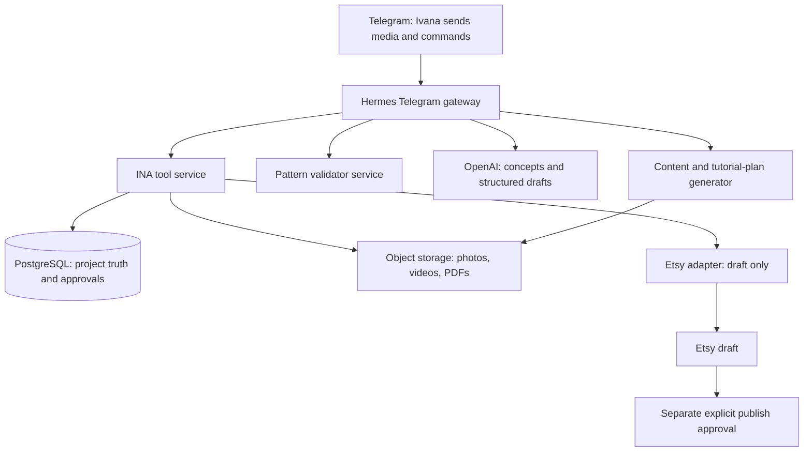

# INA Pattern Studio: Hermes agent guideline

## Purpose

Hermes is the conversational reasoning layer for INA Pattern Studio. It receives or resumes an INA design project, guides Ivana through measured design development, calls only approved tools, and produces reviewable outputs. Hermes does not become the source of truth for projects, patterns, approval status or customer data.

The agent's purpose is:

> Help Ivana turn an original, measured lampshade idea into a tested digital crochet pattern and approved content package, then prepare an Etsy **draft** listing.

## Best system structure

Use a separated system without n8n. Hermes is the Telegram bot and reasoning layer; a small INA tool service owns durable records, files, calculations and controlled Etsy writes. One all-powerful chat process would lose evidence, make bad assumptions and make approval difficult to audit.



### Component responsibilities

| Component | Responsibility | Must not do |
|---|---|---|
| Hermes Telegram gateway | Receive Telegram conversation, preserve session continuity and request approved tools | Be the only durable record or make external writes outside the tool allowlist |
| INA tool service | Store files, save project state, calculate pattern validity, enforce idempotency and make controlled external calls | Decide design quality, safety or publication authority |
| PostgreSQL | Authoritative project state, measurements, version history, tester evidence and approvals | Store raw videos or secret credentials |
| Object storage | Immutable originals and versioned output files | Decide which pattern version is approved |
| Hermes | Ask the right questions, draft structured outputs, explain constraints and invoke approved tools | Invent measurements, override approval gates or publish listings |
| Pattern validator | Deterministically calculate compatible stitch counts and test release prerequisites | Judge physical fit or safety |
| OpenAI image / text services | Concepts, pattern drafts, diagrams, blog drafts and tutorial plans | Supply engineering facts from an image |
| Etsy adapter | Upload approved PDF and create a `draft` digital listing | Move a listing to active |

## Hermes context hierarchy

Use the Hermes project-context approach verified in the existing environment: a small root `AGENTS.md` points to version-controlled project guidance; skills hold repeatable procedures; durable project state stays in a database; private Hermes memory stays private.

Do not add `.hermes.md` as a shortcut. In the known Hermes setup it can take precedence over `AGENTS.md` and hide the expected project guidance.

```text
Hermes SOUL / private memory      = tone and small runtime lessons only
INA root AGENTS.md                = concise operational entry point
hermes/GOVERNANCE.md              = authority and approval boundaries
agent/PRODUCT_REQUIREMENTS.md     = product scope and Telegram behaviours
agent/WORKFLOW.md                 = state machine and release rules
agent/schemas/                    = structured input/output contracts
PostgreSQL + object storage       = authoritative live project data and media
hermes/skills/                    = procedural task instructions
session history                   = temporary conversation context only
```

## Required project-context file

Copy [AGENTS.md](AGENTS.md) to the root of the dedicated INA Hermes checkout when that checkout is created. Do not place it in the current CABIJ Hermes checkout; INA must be isolated as its own project.

## Agent rules

1. Preserve the evidence labels: `CONFIRMED`, `UNCONFIRMED`, `INFERENCE`, `COMMERCIAL_HYPOTHESIS`, `BLOCKED`.
2. A photo or generated image is visual input only. It cannot create confirmed dimensions, gauge, material performance or safety evidence.
3. Require Ivana's explicit measurement confirmation before pattern calculation.
4. Require the deterministic validator to pass before a draft pattern is created.
5. Require two Ivana prototypes, three independent tester completions and zero open critical issues before the state can become `release_candidate`.
6. Only Ivana can move a project to `approved`.
7. Hermes may ask Etsy to create a digital `draft` only after the project is approved. Hermes must never set a listing to active.
8. Hermes may prepare blog posts, captions and an edit decision list only from the approved pattern version and real supplied footage/notes.
9. Never make a safety, certification, heat, bulb or fire claim without project-specific documented evidence.
10. Never copy, substantially derive from, or sell another creator's pattern. If provenance is uncertain, set the project state to `BLOCKED`.

## Tool allowlist

| Tool | Allowed when | Output |
|---|---|---|
| `store_source_media` | A Telegram file arrives | Immutable media reference linked to project |
| `save_measurements` | Ivana confirms values | Versioned measurement record |
| `find_material_options` | A frame and functional requirement are known | Source-backed comparison, never a safety guarantee |
| `generate_concepts` | Brief and constraints are confirmed | 3–6 labelled visual concepts |
| `validate_pattern` | Gauge, frame and motif repeat are confirmed | Machine-readable pass/fail report |
| `save_pattern_draft` | Validator passes | Versioned `not_for_sale` draft |
| `create_tester_pack` | Ivana approves the draft | Versioned PDF and feedback form |
| `record_tester_feedback` | Tester response received | Defect record linked to pattern version |
| `generate_content_package` | Pattern is approved | Reviewable blog, captions, tutorial plan |
| `create_etsy_draft` | Release gate passes and Ivana approves listing data | Etsy draft ID and readback |

There is deliberately no `publish_etsy_listing`, `post_social_media`, `send_marketing_message`, `purchase_materials`, or `claim_safety` tool.

## Telegram workflow

Hermes is the Telegram bot. Telegram is used for ingress, concise questions, button approvals and status. Long PDFs, images and videos are stored by the INA tool service and referenced by project ID.

```text
/new + photo/sketch + measurements
  → create project INA-XX
  → return extracted measurement table marked UNCONFIRMED
  → Ivana confirms or edits values
  → agent presents material options
  → Ivana selects material and concept
  → agent validates construction and drafts pattern
  → Ivana logs prototype and sends testers pack
  → agent records test results and creates corrected version
  → Ivana approves final version
  → agent generates content + Etsy draft for review
```

The bot must include the project ID, current state and next required human action in every non-trivial reply.

## Data contracts

The initial database must have these logical records:

| Record | Required fields |
|---|---|
| `projects` | ID, state, provenance status, owner, timestamps, current version IDs |
| `source_assets` | Project ID, media type, immutable storage key, source, submitted time |
| `measurements` | Project ID, dimensions, units, fitting, confirmed-by-Ivana flag, version |
| `material_options` | Supplier/product facts, source/date checked, selection decision, prototype observations |
| `patterns` | Project ID, version, structured construction, PDF reference, validator report, release status |
| `prototype_runs` | Pattern version, maker, timed build, actual material use, defects, images |
| `tester_feedback` | Pattern version, tester consent, completion state, issues, minutes of support |
| `approvals` | What was approved, exact version, approver, timestamp, audit notes |
| `content_assets` | Pattern version, source assets, draft/final state, review status |
| `etsy_drafts` | Pattern version, payload snapshot, Etsy draft ID, readback, publish status fixed to draft |

The current JSON schemas in `agent/schemas/` are the start of this contract. The database migration should mirror them, not duplicate undocumented fields.

## Build phases

### Phase A — local proof of the pattern loop

Build only: local project files, measurement form, material-library template, deterministic validator, pattern draft and tester pack. Run one non-commercial design through Ivana and three testers.

Exit condition: a pattern draft cannot bypass unconfirmed measurements or validator failure.

### Phase B — direct Telegram and Hermes intake

Configure Hermes's Telegram channel for a dedicated INA bot, then connect Hermes to the INA tool service for media storage, project creation and validation. Keep all actions read-only or internal. Test with synthetic media and no Etsy connection.

Exit condition: the same message replay does not create a duplicate project; missing measurements produce a clear question; media is stored and linked correctly.

### Phase C — structured pattern and content outputs

Connect OpenAI Structured Outputs and image generation. Generate concepts, construction specs, pattern drafts, blog drafts, captions and tutorial edit decision lists. Use the validator as a mandatory tool.

Exit condition: every output names its project and pattern version, and no content is generated from a non-approved pattern.

### Phase D — Etsy draft integration

Register a dedicated Etsy seller app, connect OAuth, create a digital draft listing, upload a test PDF and read back its state. Do not activate it.

Exit condition: draft is present with correct file/version; an attempt to call a publish path is denied by the adapter.

### Phase E — video draft export

Choose a video-processing provider or local worker. Start by making a reviewable two-minute draft from a human-approved edit decision list.

Exit condition: original footage remains preserved and the final output is linked to the correct pattern version.

## Acceptance tests before any live launch

1. Fresh Hermes Telegram session identifies INA project rules and uses the correct project context.
2. A photo with missing height results in a clarification, not a guessed measurement.
3. A frame/gauge/motif combination without a viable stitch repeat is rejected with alternatives.
4. A pattern with one prototype or two testers cannot create an Etsy draft.
5. A blog draft from an unapproved pattern is rejected.
6. Etsy draft creation contains `type: download` and the approved PDF version.
7. A request to publish returns `needs_human_approval` and does not call Etsy.
8. Duplicate Telegram delivery does not duplicate a project, media record or Etsy draft.
9. Every action is recorded with project ID, pattern version, actor, source inputs and result.

## Deployment boundary

This repository now contains the project pack. It does not configure Hermes, install a skill, create a Telegram bot, register Etsy, connect OAuth or send a message. Those require a dedicated INA deployment environment, credentials and a reviewed test plan.
