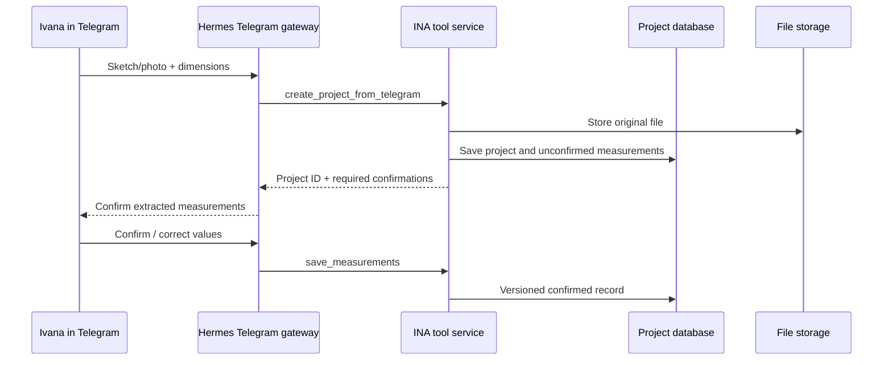

# Direct Hermes Telegram build

## Decision

INA will not use n8n. A dedicated Telegram bot is connected directly to the Hermes gateway. Hermes calls one narrowly scoped INA tool service for project data, media, validation and draft-only Etsy work.



## Minimum services

| Service | Required purpose |
|---|---|
| Hermes gateway | Direct Telegram conversation, skills, session state and tool calling |
| INA tool service | One private HTTP/MCP service that enforces data schemas and approval gates |
| PostgreSQL | Project, measurement, material, pattern, tester and approval records |
| Object storage | Original Telegram media, generated images, PDFs and video outputs |
| OpenAI credentials | Concept imagery and structured pattern/content drafts, called only through approved functions |

Hermes's private memory is not a replacement for the project database. Telegram attachments are not a replacement for object storage.

## INA tool service API

Expose only these endpoints or MCP tools in the first deployment:

```text
create_project_from_telegram(message_id, sender_id, text, attachments)
get_project(project_id)
save_measurements(project_id, measurement_version, confirmed_values)
find_material_options(project_id)
save_material_selection(project_id, material_option_id, approved_by)
validate_pattern(project_id, construction_spec)
save_pattern_draft(project_id, pattern_version, draft)
create_tester_pack(project_id, pattern_version)
record_tester_feedback(project_id, pattern_version, feedback)
check_release_gate(project_id, pattern_version)
create_etsy_draft(project_id, pattern_version, listing_payload)
```

Do not expose a generic shell, arbitrary HTTP, database-query, publishing or social-posting tool to Hermes.

## Telegram bot controls

- Allowlist Ivana's Telegram user ID before accepting commands.
- Require a project ID for all updates after `/new`.
- Deduplicate every inbound event on Telegram message ID before saving data or files.
- Save original files before asking Hermes to reason over them.
- Use inline buttons for `Confirm measurements`, `Choose material`, `Choose concept`, `Approve tester pack`, `Approve release`, and `Create Etsy draft`.
- Do not offer a `Publish Etsy` button in the initial bot.
- Include project ID, state and next required action in every response.

## Dedicated Hermes project

Run INA in its own Hermes workspace and repository. Do not reuse the CABIJ production checkout or its memory. The INA root `AGENTS.md` must load the INA governance and skill instructions. The first direct Telegram session must be tested to prove this context actually appears; existing Hermes notes establish WebUI context loading but do not prove Telegram parity.

## Direct deployment sequence

1. Provision database and object-storage buckets for INA only.
2. Build and test the tool service locally using synthetic Telegram payloads.
3. Run the existing pattern-validator tests and API contract tests.
4. Create a dedicated Telegram bot and record its token only in deployment secrets.
5. Configure the Hermes Telegram channel to use the INA workspace and only the INA tool-service allowlist.
6. Send `/new` from Ivana's allowlisted account with a synthetic image; confirm the new project and attachment are stored once.
7. Test a failed measurement, failed repeat validation and unapproved Etsy-draft request.
8. Test a full non-commercial pattern project through three testers.
9. Add Etsy OAuth and draft-only creation after the earlier stages pass.

## Acceptance checks

- A non-allowlisted Telegram account is rejected without creating a project.
- Replaying a Telegram update cannot duplicate source media, projects or pattern versions.
- Hermes cannot call an unlisted tool.
- A calculation request with unconfirmed gauge returns `needs_measurement`.
- A request to publish an Etsy listing returns `needs_human_approval`; no Etsy publish request is made.
- A fresh Telegram Hermes session reports the INA project context and the approved tool set.

## Runtime verification required

The existing Hermes environment documents that fresh WebUI sessions loaded project context, while Telegram context parity was not verified in those notes. Before treating a direct Telegram configuration as ready, run a fresh INA Telegram test that checks the working project context, skill visibility and tool allowlist without reading private runtime files or exposing credentials.
